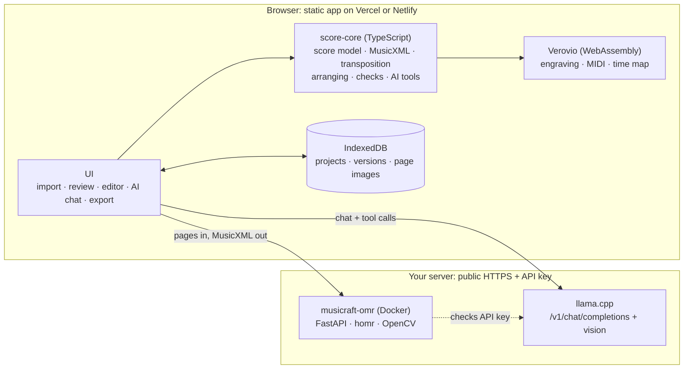

# Musicraft: project plan

> **Status:** draft for review (2026-10-28). Nothing is built yet; this document is what we agree on before building.

Musicraft is a web app that turns sheet music (PDFs and phone photos) into an editable digital score, and then lets you change it:

- **Digitize.** Optical music recognition (OMR) reads PDFs and photos. A review screen shows the original page next to the digital result and flags bars that look wrong.
- **Transform.** Transpose, switch instruments (Bb trumpet → Bb clarinet, Bb trumpet → C trumpet), and arrange (piano → brass quintet).
- **Ask the AI.** Describe a change in plain language. Your llama.cpp model applies it through a set of music tools, and you see a preview before accepting it.
- **Edit by hand.** Change individual notes, rhythms, accidentals, articulations, dynamics and bars.
- **Export.** PDF (full score and individual parts), MusicXML, MIDI, MEI, and a project file.

I read "make notifications" in the brief as "make modifications".

## 1. Decisions so far

| Topic | Decision |
|---|---|
| Hosting | Static web app on Vercel or Netlify, reachable from anywhere. No serverless functions needed. |
| Access control | API keys you generate on your server. The app keeps the key in your browser and sends it only to your server. The app has no accounts of its own. |
| AI | Your llama.cpp server (vision-capable, strong reasoning) through its OpenAI-compatible API at `https://linuxllm.ling-escalator.ts.net/v1`. |
| Recognition (OMR) | A companion Docker container on your server, next to llama.cpp, accepting the same API keys. |
| Main input | Piano / grand-staff music. Single-instrument parts like your trumpet part also work. |
| First arranging target | Small brass ensembles, brass quintet first. |
| Storage | Browser only (IndexedDB). Project files can be exported and imported to move work between devices. |

## 2. Feasibility tests

Before planning I ran the key building blocks in the development sandbox: homr 0.7.0 (open-source OMR, AGPL-3.0) on 4 CPU cores, and Verovio 6.3.0 (music engraving library, LGPL-3.0).

### 2.1 homr on your trumpet photo

The copy of the photo attached to the chat is only 899×1599 px (about 9 px between staff lines). The app will upload full-resolution originals, which should do better.

- **Speed:** 35 s on CPU, including the one-time model download.
- **4/4 sections (rehearsal 84–131):** mostly right. Pitches, rhythms, accidentals and slurs were correct in the large majority of bars, and every key change was found. Errors I confirmed:
  - a missing 16th note, a missing dot and a missing barline;
  - the natural signs at one key change read as a whole note;
  - marcato accents read as plain accents;
  - one doubtful chromatic triplet bar.

  The missing note, dot and barline each leave a bar that doesn't add up to 4/4, so the app can flag them automatically.
- **Not captured:** multi-measure rest counts (the 2-, 4-, 6-, 7- and 10-bar rests each became one bar), tempo and section text ("Marcia", "THE MARCH OF THE VILLAINS"), rehearsal numbers, and dynamics. It did read the header "1st Bb TRUMPET".
- **12/8 Finale:** the time signature was read as 2/2, which broke the rhythms of that section. A phantom bass clef on the last two lines shifted every pitch after it.

### 2.2 homr on a piano page

The input was page 1 of Joplin's *Maple Leaf Rag* (public domain, from the music21 corpus): 36 bars, grand staff, 4 flats, dense chords, clef changes and first/second endings. I rendered it once as a clean 300-dpi page and once as a simulated phone photo (perspective, uneven lighting, blur, noise, JPEG), then compared homr's output with the source file.

| Input | Time (CPU) | Treble staff, 196 notes/chords: pitch / pitch + rhythm | Bass staff, 139 notes/chords: pitch / pitch + rhythm |
|---|---|---|---|
| Clean page | 61 s | 100% / 100% | 99% / 99% |
| Simulated photo | 43 s | 100% / 100% | 99% / 99% |

Percentages are sequence similarity of notes and chords in reading order. Key signature, time signature, bar count and clef changes were also correct. Dynamics, tempo text and first/second endings were dropped, and ties came out as slurs.

**Caveat:** Verovio drew this page, and several OMR training sets are drawn with Verovio, so this is a best case. Real scans and photos of older engravings will score lower, as the trumpet photo shows. Milestone M2 adds a benchmark built from real scans.

### 2.3 Verovio as the renderer

- Note IDs in the MusicXML carry through to the rendered SVG, so clicking a note on the page can select it in the score data.
- Its transposition works, and it produces MIDI plus a time map (which note sounds when) for playback with highlighting.
- It rendered homr's output without errors.

### 2.4 What this means for the design

1. OMR gives a good first draft, not a finished score. The review screen and the editor are core features, not extras.
2. Cheap automatic checks catch many errors: bars that don't add up, sudden clef or time-signature changes, notes outside an instrument's range.
3. Post-processing fixes homr's known habits, for example a slur between two notes of the same pitch becomes a tie.
4. The vision model fills homr's gaps: text, dynamics, tempo, rehearsal marks, multi-measure rest counts and endings. It also gives a second opinion on time signatures and clefs.
5. The app uploads full-resolution images and lets you fix the page corners of photos.

## 3. Architecture

**Principle: the score lives in the browser.** Your server only does the heavy computing (recognition and the language model). All music logic (transposition, instrument changes, range checks, arranging, validation) is TypeScript that runs in the browser, so editing is instant and works offline. The AI never edits files directly; it calls the same operations the UI uses.



### 3.1 Web app (`apps/web`)

- Vite + React + TypeScript, installable as a PWA (progressive web app) on phones and tablets.
- Verovio runs as WebAssembly in a background worker. It draws the pages and produces MIDI, the time map, and the SVG used for PDF export.
- **Editor:** a selection layer over Verovio's SVG, using the shared element IDs. Keyboard-first (MuseScore-like shortcuts) plus a touch palette.
- **Playback:** Verovio's MIDI played through a SoundFont synthesizer in the browser (for example SpessaSynth), with per-part mute/solo, tempo control and note highlighting.
- **Import:** drag and drop PDFs, images or MusicXML, or use the phone camera. Page thumbnails via pdf.js; corner adjustment for photos.
- **Storage:** IndexedDB (via Dexie) holds projects, version history, original page images and OMR results. Export and import as a `.musicraft` file: a zip of the score data, MusicXML, images and history.
- **Settings:** server URLs, API key, model (detected from `/v1/models` and `/props`), and a connection test.

### 3.2 Score engine (`packages/score-core`)

- **Score model:** parts → staves → bars → voices → notes, chords and rests. Durations are exact fractions. It covers tuplets, ties, slurs, articulations, dynamics, tempo, text, rehearsal marks, repeats and endings, and multi-measure rests (a layout feature for parts).
- **Concert pitch inside.** Pitches are stored at sounding pitch with full spelling; the written pitch of transposing instruments is computed for display and export. Changing instruments is then lossless, and "concert pitch" becomes a view toggle, as in Dorico and MuseScore.
- **Stable IDs** on every element, exported as MusicXML `id` attributes, which Verovio carries into the SVG (verified in 2.3).
- **MusicXML 4.0** import and export (`.musicxml` and compressed `.mxl`).
- **Instrument catalog** (JSON): names, transposition, clefs, full and comfortable range, MIDI program and MusicXML sound ID. Brass first, plus the common band and orchestral instruments needed for transposing parts.
- **Ensemble templates:** brass quintet (2 trumpets, horn in F, trombone, tuba) with Bb- or C-trumpet variants, plus brass quartet and trio. User-defined templates later.
- **Operations:** every change, from the UI or the AI, is a typed operation that is validated and then applied without mutating the previous version. This gives undo/redo and a history that shows who (you or the AI) changed what.
- **Checks:** bar lengths against the time signature, instrument ranges, suspicious clef or time changes, and similar. They are shown in the UI and given to the AI.
- **AI notation:** a compact text format for bars, one line per bar, with absolute pitches and explicit durations, for example `bar 12: Bb4/4. C5/8 D5/2` and `bar 13: [F4 A4 C5]/2 r/2`. It has a strict parser with precise error messages the model can act on; the exact syntax is settled in M4.

### 3.3 Recognition service (`services/omr`, Docker on your server)

- Python 3.12, FastAPI and homr (ONNX Runtime). It uses CUDA or ROCm if available and the CPU otherwise. homr's models total about 150 MB, small next to an LLM. OpenCV handles image cleanup, PyMuPDF renders PDFs, and pillow-heif reads iPhone photos.
- **Pipeline:** decode → find the page and correct perspective (corners adjustable in the app) → optional cleanup (deskew, shading) → homr → post-processing (slur → tie, consistency checks) → MusicXML plus image positions of systems, bars and notes. The positions drive the side-by-side review and the image crops sent to the vision model.
- **API:** `GET /health`, `POST /v1/pages/detect`, `POST /v1/omr/jobs`, `GET /v1/omr/jobs/{id}` (progress and results), `DELETE /v1/omr/jobs/{id}`.
- **Stateless:** jobs and files are deleted after a few hours. Your browser keeps the project.
- **Auth:** a Bearer API key. By default the service checks a key by calling your llama.cpp endpoint (`GET /v1/models`) with it and caching the answer, so any key your server already accepts works without extra setup. A key file is the alternative.
- **Limits:** CORS restricted to the app's domain(s), plus upload-size and page-count limits.
- **Optional second engine:** Audiveris 5.10 (AGPL-3.0, Java), evaluated in M2 on clean PDFs, where it also reads text and dynamics. It is dropped if it adds nothing.
- **Delivery:** a Docker image (built by CI and published to GitHub Container Registry) plus a `docker compose` file. It is exposed the same way as llama.cpp, for example on the same Tailscale Funnel host under `/omr`.

### 3.4 AI assistant

- The browser calls your llama.cpp server directly (`/v1/chat/completions`, streamed). llama.cpp's default CORS reflects the caller's origin; a proxy in front of it must allow the app's origin.
- It uses OpenAI-style tool calling, which works through llama.cpp's Jinja chat templates (on by default). Output constrained to a JSON schema is the fallback for chat templates without tool support.
- **Agent loop in the browser:**
  1. The model receives a system prompt (role, conventions, notation spec), a compact overview of the score, and your request.
  2. It calls tools, which the app applies to a draft copy. Errors go back to the model so it can fix them.
  3. You get a summary and a highlighted preview, then accept or discard. Each accepted change is an undoable version.
- **First tool set:**
  - Read: `get_overview`, `get_bars`, `get_issues`, `analyze_harmony`, `list_instruments`.
  - Write: `transpose`, `change_instrument`, `add_part`/`remove_part`, `write_bars` (AI notation), `copy_bars`, `shift_octave`, `set_key`/`set_time`/`set_tempo`, `add_dynamics`/`add_articulations`, `insert_bars`/`delete_bars`, and `arrange` (runs the deterministic arranger).
  - Vision: `look_at_page` (sends a crop of the original page).
- **Vision proofreading after OMR:** for each system, the model gets the original crop and the rendered recognition. It returns structured findings (bar, problem, suggested fix) plus the text and dynamics homr missed. You confirm each one.
- **Context budget:** read from `/props` (`n_ctx`). The model asks for bar ranges as needed and never gets the whole score at once.

### 3.5 Arranging: piano → brass quintet

The app writes a deterministic first draft, which you or the AI then refine:

1. **Analyse the piano part:** melody (top line), bass (lowest line), harmony per beat, and accompaniment figures (arpeggios, stride, Alberti bass).
2. **Assign lines:** trumpet 1 takes the melody and the tuba the bass. Trumpet 2, horn and trombone take the inner voices, with smooth voice-leading and complete chords, inside comfortable ranges.
3. **Make it brass-idiomatic:** arpeggio and stride figures become sustained or rhythmic chords. Long phrases get breathing places, sustained extreme ranges are avoided, and the melody is shared out (for example, the horn or trombone takes some phrases).
4. **Write parts at written pitch:** Bb trumpet a major 2nd up, horn in F a perfect 5th up, trombone and tuba at concert pitch in bass clef.
5. **Report** range and playability warnings per part.

Then you can ask things like "give the B section melody to the horn", "add a trombone countermelody in bars 17–24" or "make it easier for an amateur group".

### 3.6 Transposition (deterministic, in M1)

- **Bb trumpet → Bb clarinet:** both are in Bb, so the written notes stay the same. The part gets the clarinet's name, sound and range checks.
- **Bb trumpet → C trumpet:** written notes go down a major 2nd. The keys in your part change as follows: C major → Bb major, G major → F major, Eb major → Db major, F major → Eb major.
- **General:** any instrument to any instrument, by interval or to a target key, with octave choice, simplification of extreme keys (for example C# major → Db major), and range warnings.

### 3.7 Export

- **PDF:** full score (concert or transposed) and individual parts with multi-bar rests combined, A4 or Letter, adjustable staff size. Rendered in the browser from Verovio's SVG.
- **MusicXML** (`.musicxml` / `.mxl`) for MuseScore, Dorico, Sibelius, Finale and others.
- **MIDI** for playback, DAWs and practice.
- **MEI**, which Verovio provides at no extra cost, for scholarly tools.
- **Project file** (`.musicraft`) for backup and moving between devices.
- **Later:** audio practice tracks (WAV), MuseScore files (`.mscz`), and MuseScore-engraved PDFs produced by the container.

### 3.8 Security and privacy

- The web app is public, but it cannot do anything without your API key. The key lives only in your browser's storage and goes only to the server URLs you set.
- Only your server sees page images and prompts. Vercel or Netlify only serve the app's static files.
- The app ships a strict Content-Security-Policy. AI output is never inserted as HTML, and tool arguments are schema-validated.
- Your scans stay in your browser and on your server. The public repo only contains public-domain, CC0 or self-made test material, so your Superman part will not be committed.

## 4. Repository layout

```
musicraft/
├── apps/web/              React + Vite app (PWA)
├── packages/score-core/   score model, MusicXML, transposition, arranging, AI tools (TypeScript)
├── services/omr/          FastAPI recognition service + Dockerfile
├── deploy/                docker compose for your server; Vercel and Netlify config
├── docs/                  this plan, server setup guide, architecture notes
└── .github/workflows/     CI: lint, type check, tests, build, Docker image
```

Tooling: pnpm workspaces, strict TypeScript, Vitest, Playwright and ESLint/Prettier on the web side; uv, ruff and pytest for Python.

## 5. Milestones

Each milestone is one pull request (or a short series) and is usable on its own.

| # | Milestone | Afterwards you can… |
|---|---|---|
| M0 | **Scaffolding:** monorepo, CI, Vercel/Netlify config, OMR service skeleton with auth and health check | deploy the empty app and container and run a connection test against your server |
| M1 | **Score workbench:** MusicXML import, rendering, parts and instruments, transposition and instrument change, range warnings, basic playback, PDF/MusicXML/MIDI export, browser storage and project files | turn a MusicXML trumpet part into a C-trumpet or clarinet part and print it |
| M2 | **Digitize:** OMR service with homr, page detection and perspective correction, import wizard (PDF, photos, camera), review screen with flagged bars, post-processing fixes, accuracy benchmark | photograph a page and get a score you can play back and export |
| M3 | **Manual editor:** selection; pitch, rhythm, accidental and tie edits; insert and delete; chords and voices; key, time and clef changes; articulations, dynamics, text and tempo; bar operations; copy/paste; undo/redo; shortcuts and touch palette | fix recognition errors and make your own changes |
| M4 | **AI assistant:** settings and model detection, chat with tool calling, change previews, vision proofreading of OMR results | ask "make this a C trumpet part and move bars 17–24 down an octave" |
| M5 | **Arranging:** piano → brass quintet arranger, ensemble templates, part extraction, AI arranging tools, playability report | turn a piano piece into a quintet score with parts |
| M6 | **Polish:** better playback (sound fonts, mixer), offline/PWA polish, MuseScore engraving option, Audiveris if the benchmark justifies it, more ensembles | — |

M1 comes first because everything builds on the score model. The server half of M2 can start alongside it, so you can try recognition on your own music early.

## 6. Testing

- **score-core:** unit tests for transposition (every instrument and key), MusicXML round trips on real files (music21 corpus, OpenScore CC0), the AI-notation parser, the checks, and arranging invariants (bar lengths, ranges).
- **OMR service:** API, auth and job tests. An accuracy benchmark on public-domain pages (clean, photo-like and real scans) is tracked over time; it is informational and does not block merges.
- **Web:** component tests and Playwright end-to-end tests (import → transpose → export) against a mock OpenAI-compatible server and recorded OMR responses.
- **Live tests against your server:** done by you, or by me if you make the host reachable from my sandbox (open question 5).

## 7. Risks

| Risk | Mitigation |
|---|---|
| Recognition errors on real photos and older prints | Review screen with automatic flags, vision proofreading, full-resolution uploads, a fast editor, and an engine choice driven by the benchmark |
| The local model makes tool-calling mistakes | A small, strict tool set; schema validation that feeds errors back to the model; deterministic tools do the music theory; preview before applying |
| Browser-only storage can be wiped. Safari on iPhone/iPad can delete a site's data after 7 days of use without a visit; apps installed to the Home Screen are exempt. | Request persistent storage, encourage installing the app, remind you to export projects. Optional sync through your server later. |
| Public endpoints on your server | API keys, CORS limited to the app, HTTPS only, upload limits |
| Arrangements sound mechanical | Treat them as first drafts, refined by the AI and by hand, and audition them with playback |
| GPU contention with llama.cpp | homr's models are about 150 MB; the CPU fallback measured 35–61 s per page |
| Licensing | The repo is GPL-3.0. homr and Audiveris are AGPL-3.0 and run as a separate service; Verovio is LGPL-3.0. All compatible. |

## 8. Open questions

1. **API keys:** how does your server issue and check keys (llama-server `--api-key` / `--api-key-file`, or a proxy or gateway in front)? By default the OMR service checks keys by asking your LLM endpoint; tell me if that won't work.
2. **Outside access:** how is the server reachable from outside the tailnet (Tailscale Funnel, a reverse proxy, something else)? I'd expose the OMR service the same way, for example under `/omr` on the same host.
3. **Model:** the exact model name and context size, i.e. the output of `GET /v1/models` and `GET /props`.
4. **Hardware:** GPU type and how much VRAM is free next to the model. homr can use CUDA or ROCm; the CPU also works.
5. **Live testing from my sandbox:** do you want this? It needs the host publicly reachable, added to this environment's allowed domains, and a dedicated API key stored as an environment secret. Otherwise I test against mocks and you verify against the real server.
6. Minor, with defaults assumed: Bb trumpets in the quintet template (C is one click away), and configs for both Vercel and Netlify.

## 9. Next step

Once you approve, or adjust, this plan, I start with **M0 + M1** and the **OMR container skeleton**, so you can deploy the app and the container early and test them against your own server.
